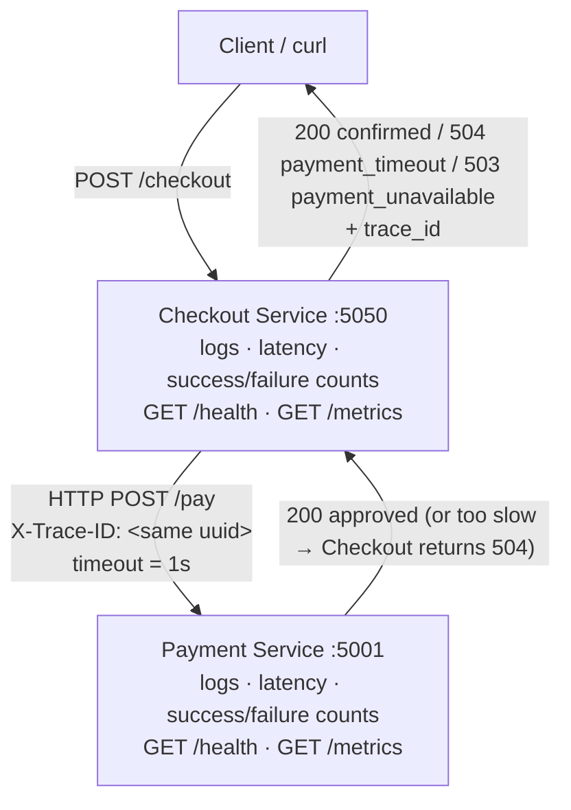
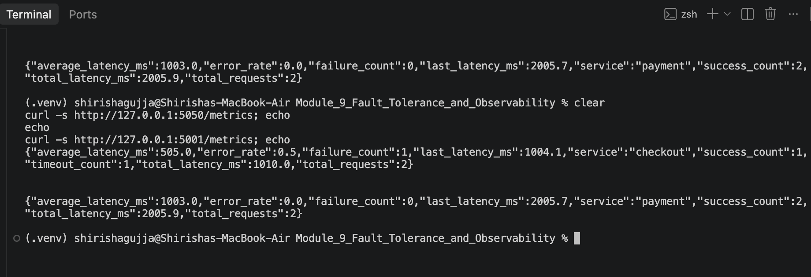
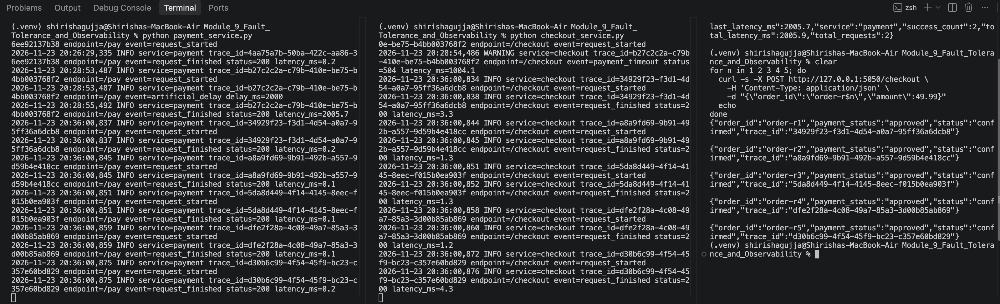
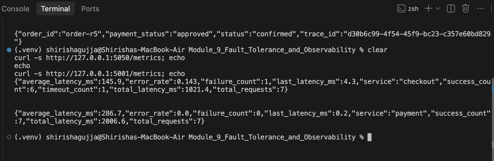

# CMPE 273 – Module 9: Fault Tolerance & Observability

## 1. Overview

This project has two independent Python/Flask services that run as **separate processes** and talk over **HTTP/JSON**:

- **Checkout Service** (`checkout_service.py`, port **5050**) receives `POST /checkout` from a client and calls the Payment Service over HTTP with a **1-second timeout**.
- **Payment Service** (`payment_service.py`, port **5001**) handles `POST /pay` and approves the (fake) payment. For failure testing it can be slowed down on purpose with `?delay_ms=N`.

Both services have basic observability:

- **Request logs** (Python `logging`) with `service`, `trace_id`, `endpoint`, `event`, `status`, `latency_ms`
- **Request latency** measured with `time.monotonic()`
- **In-memory metrics** (`total_requests`, `success_count`, `failure_count`, `error_rate`, `last_latency_ms`, `average_latency_ms`) at `GET /metrics`
- **A shared trace ID**: Checkout generates a UUID per request and sends it to Payment in the `X-Trace-ID` header

When Payment is slow, Checkout returns a clean **504** instead of crashing. The logs, metrics and trace ID show which dependency failed, when it failed, and that the system recovered afterwards.

> **Port note:** The assignment suggests port 5000 for Checkout, but on macOS port 5000 is already used by the AirPlay Receiver (`ControlCenter`). Checkout therefore runs on **5050**. You can change it with `CHECKOUT_PORT=...` (and Payment with `PAYMENT_PORT=...`).

## 2. Architecture Diagram



| Endpoint | Service | Purpose |
|---|---|---|
| `POST /checkout[?payment_delay_ms=N]` | Checkout | Process an order (calls Payment). `payment_delay_ms` is forwarded to Payment for failure testing |
| `POST /pay[?delay_ms=N]` | Payment | Approve payment. `delay_ms` (0–5000) adds an artificial delay |
| `GET /health` | both | Liveness check |
| `GET /metrics` | both | JSON metrics (not Prometheus) |

Failure handling in Checkout:

| Situation | Checkout response |
|---|---|
| Payment answers in under 1 s | `200` `{"status":"confirmed", ...}` |
| Payment takes longer than 1 s (`requests.Timeout`) | `504` `{"error":"payment_timeout"}` |
| Payment unreachable (other `requests.RequestException`) | `503` `{"error":"payment_unavailable"}` |
| Payment returns non-200 | `502` `{"error":"payment_failed"}` |
| Malformed client input | `400` with an error message |

## 3. Install Dependencies

```bash
python3 -m venv .venv
source .venv/bin/activate
python -m pip install -r requirements.txt
```

`requirements.txt` contains only `Flask` and `requests`. Tested with Python 3.9.6, Flask 3.1.3 and requests 2.32.5.

## 4. Running Both Services

Open three terminals (in VS Code: **Terminal → New Terminal**, then click the split icon twice). In each one:

```bash
cd Module_9_Fault_Tolerance_and_Observability
source .venv/bin/activate
```

**Terminal 1 — Payment**

```bash
python payment_service.py
```

**Terminal 2 — Checkout**

```bash
python checkout_service.py
```

**Terminal 3 — Client (health checks)**

```bash
curl -i http://127.0.0.1:5001/health
curl -i http://127.0.0.1:5050/health
curl -s http://127.0.0.1:5050/metrics; echo
```

**Screenshot 1: Payment (left) and Checkout (middle) started; both `/health` checks return 200 and metrics start at zero (right).**


> All evidence below comes from **one continuous run** on 2026-11-23. The services were not restarted and the metrics were never reset.

## 5. Successful Request Evidence

```bash
curl -i -X POST http://127.0.0.1:5050/checkout \
  -H 'Content-Type: application/json' \
  -d '{"order_id":"order-123","amount":49.99}'
echo
curl -s http://127.0.0.1:5050/metrics; echo
```

**Screenshot 2a: the client receives `200 OK`, `"status":"confirmed"` and trace ID `4aa75a7b-50ba-422c-aa86-36ee92137b38`. Metrics show `success_count` 1 and `failure_count` 0.**


**Screenshot 2b: the same trace ID in Payment's log (left, 0.2 ms) and Checkout's log (right, 5.9 ms).**


Key lines:

```text
checkout trace_id=4aa75a7b-50ba-422c-aa86-36ee92137b38 endpoint=/checkout event=request_finished status=200 latency_ms=5.9
payment  trace_id=4aa75a7b-50ba-422c-aa86-36ee92137b38 endpoint=/pay      event=request_finished status=200 latency_ms=0.2
```

## 6. Timeout Failure Evidence

Payment is told to sleep **2000 ms**, but Checkout only waits **1000 ms**:

```bash
curl -i -X POST 'http://127.0.0.1:5050/checkout?payment_delay_ms=2000' \
  -H 'Content-Type: application/json' \
  -d '{"order_id":"order-timeout","amount":49.99}'
echo
curl -i http://127.0.0.1:5050/health
```

**Screenshot 3: the timeout traced across both services with trace ID `b27c2c2a-c79b-410e-be75-b4bb003768f2`. Payment (left) sleeps 2000 ms and finishes later with 200. Checkout (middle) gives up after about 1000 ms and logs `payment_timeout status=504`. The client (right) receives `504 GATEWAY TIMEOUT` with `{"error":"payment_timeout", ...}`.**


**The timeout does not cancel Payment's work.** Checkout gave up at `20:28:54,486`, but Payment kept sleeping and finished its own request at `20:28:55,492` (2005.7 ms) with status 200. Nobody was waiting for that response anymore. The timeout only stops Checkout from waiting.

## 7. Checkout Still Running Evidence

The `/health` call right after the 504 (bottom right of Screenshot 3) returned:

```text
HTTP/1.1 200 OK
{"service":"checkout","status":"ok"}
```

Checkout caught `requests.Timeout`, returned a JSON error instead of a traceback, and kept serving requests.

## 8. Metrics Evidence

```bash
curl -s http://127.0.0.1:5050/metrics; echo
curl -s http://127.0.0.1:5001/metrics; echo
```

**Screenshot 4: metrics after the failure.**



Checkout metrics across the whole run:

| Moment | total | success | failure | error_rate | last_latency_ms | average_latency_ms |
|---|---|---|---|---|---|---|
| Baseline (Screenshot 1) | 0 | 0 | 0 | 0.0 | 0.0 | 0.0 |
| After 1 success (Screenshot 2a) | 1 | 1 | 0 | 0.0 | 5.9 | 5.9 |
| **After timeout** (Screenshot 4) | 2 | 1 | 1 | **0.5** | **1004.1** | 505.0 |
| After 5 recovered requests (Screenshot 6) | 7 | 6 | 1 | **0.143** | **4.3** | 145.9 |

- After the timeout, `failure_count` and `timeout_count` went from 0 to 1, and `error_rate` jumped to **0.5**.
- The timed-out request took **1004.1 ms**, compared with 5.9 ms for the normal one.
- Payment's metrics count the slow request as a **success** (`last_latency_ms` 2005.7), because it did return 200, just too late. Only Checkout counts it as a failure. You need both services' metrics to see the full picture: Payment was **slow**, not broken.

## 9. Trace-ID Evidence

Failed request, trace ID **`b27c2c2a-c79b-410e-be75-b4bb003768f2`** (from Screenshot 3):

```text
Checkout:
20:28:53,481 service=checkout trace_id=b27c2c2a-c79b-410e-be75-b4bb003768f2 endpoint=/checkout event=request_started
20:28:54,486 service=checkout trace_id=b27c2c2a-c79b-410e-be75-b4bb003768f2 endpoint=/checkout event=payment_timeout status=504 latency_ms=1004.1

Payment:
20:28:53,487 service=payment  trace_id=b27c2c2a-c79b-410e-be75-b4bb003768f2 endpoint=/pay event=request_started
20:28:53,487 service=payment  trace_id=b27c2c2a-c79b-410e-be75-b4bb003768f2 endpoint=/pay event=artificial_delay delay_ms=2000
20:28:55,492 service=payment  trace_id=b27c2c2a-c79b-410e-be75-b4bb003768f2 endpoint=/pay event=request_finished status=200 latency_ms=2005.7
```

The client got this same ID back in the 504 body. With it you can search both terminals and rebuild the whole story of one request: Checkout started, Payment received the request 6 ms later, Payment was artificially slow, Checkout gave up after about 1 s, and Payment finished on its own about 1 s after that. Without the shared ID, you could not reliably tell which Payment log line belongs to which Checkout request.

## 10. Recovery Evidence

To remove the delay, just send normal requests without `payment_delay_ms`. Nothing was restarted:

```bash
for n in 1 2 3 4 5; do
  curl -s -X POST http://127.0.0.1:5050/checkout \
    -H 'Content-Type: application/json' \
    -d "{\"order_id\":\"order-r$n\",\"amount\":49.99}"
  echo
done
```

**Screenshot 5: all five requests return `"status":"confirmed"`. Payment (left) logs `status=200` in 0.1–0.2 ms, and Checkout (middle) logs `status=200` in 1.2–4.3 ms, with matching trace IDs.**



Then check the metrics again:

```bash
curl -s http://127.0.0.1:5050/metrics; echo
curl -s http://127.0.0.1:5001/metrics; echo
```

**Screenshot 6: metrics after recovery.**



- **Error rate decreased:** 0.5 (1 of 2) → **0.143** (1 of 7). The metrics were never reset; the new successes lowered the cumulative rate on their own.
- **Failure count stopped increasing:** it stayed at 1, while `success_count` went from 1 to 6. Payment shows 7 of 7 successes.
- **Latency returned to normal:** recovered Checkout requests took 3.3, 1.3, 1.3, 1.2 and 4.3 ms. That is in line with the 5.9 ms baseline, compared with 1004.1 ms for the timed-out request. `average_latency_ms` (145.9) is still pulled up by the single slow request, because it is a cumulative average.

### Extra: other failure paths (verified in an earlier test run)

These were checked in a separate, earlier run and are not in the screenshots. The output is real.

- **Malformed input** (`{"order_id":"","amount":-1}`) → `400` `{"error":"order_id must be a non-empty string", ...}`
- **Payment stopped** (Ctrl+C in Terminal 1) → Checkout returns `503` `{"error":"payment_unavailable", ...}`, and `/health` still returns 200. Checkout log:

```text
WARNING service=checkout trace_id=28bc05f6-5822-4f1c-93f5-8c57fb1dee5c event=payment_unreachable error=ConnectionError
WARNING service=checkout trace_id=28bc05f6-5822-4f1c-93f5-8c57fb1dee5c endpoint=/checkout event=payment_unavailable status=503 latency_ms=1.7
```

## 11. Screenshots / Logs / Terminal Output

| # | File | Shows |
|---|---|---|
| 1 | [`screenshots/01-startup.png`](screenshots/01-startup.png) | Both services started, `/health` 200, metrics at zero |
| 2a | [`screenshots/02a-success-client.png`](screenshots/02a-success-client.png) | Successful checkout response and metrics |
| 2b | [`screenshots/02b-success-logs.png`](screenshots/02b-success-logs.png) | Same trace ID in Payment and Checkout logs |
| 3 | [`screenshots/03-timeout.png`](screenshots/03-timeout.png) | 504 timeout, matching trace ID in both logs, `/health` still 200 |
| 4 | [`screenshots/04-metrics-after-failure.png`](screenshots/04-metrics-after-failure.png) | Failure count, error rate and latency after the timeout |
| 5 | [`screenshots/05-recovery-requests.png`](screenshots/05-recovery-requests.png) | Five successful requests after the delay was removed |
| 6 | [`screenshots/06-metrics-after-recovery.png`](screenshots/06-metrics-after-recovery.png) | Error rate down to 0.143, latency back to normal |

All screenshots and log excerpts come from real runs. None of the trace IDs, logs, metrics or latency values were made up.

The `NotOpenSSLWarning` from urllib3 visible when Checkout starts appears because macOS's system Python is built with LibreSSL. It does not affect plain-HTTP calls to localhost.

## Reflection

**How do logs, traces, and metrics help diagnose failures in a distributed system?**

Logs tell us what happened inside each service. In this lab, Checkout logged a `payment_timeout` with status 504 after about 1000 ms, and Payment logged that it was artificially delayed. The shared trace ID connects those separate log lines, so I could follow one exact request from Checkout into Payment and see that Payment was slow rather than crashed. Metrics show the bigger pattern that a single log line can't, like the error rate jumping to 0.5 and latency spiking to over a second, which tells us that something is wrong and when it started. Together they point to which dependency failed. They also let us confirm recovery: after the delay was removed, the error rate dropped to 0.143 and latency went back to a few milliseconds.
