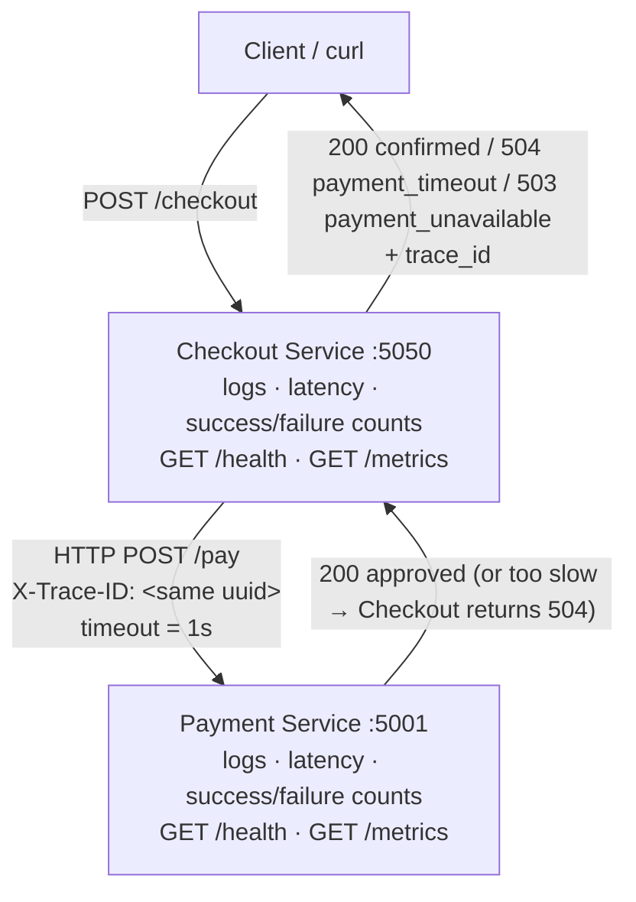
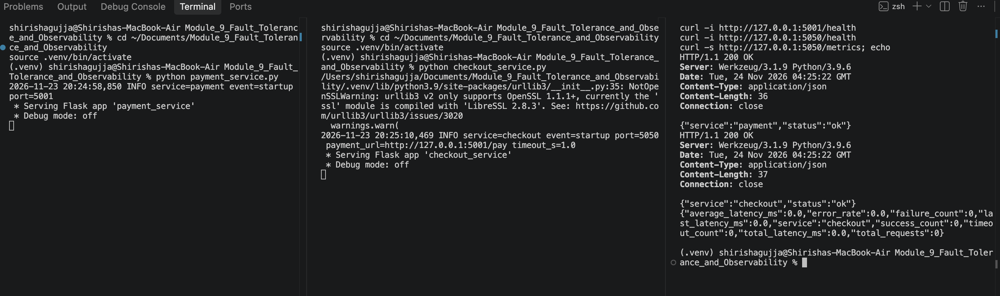
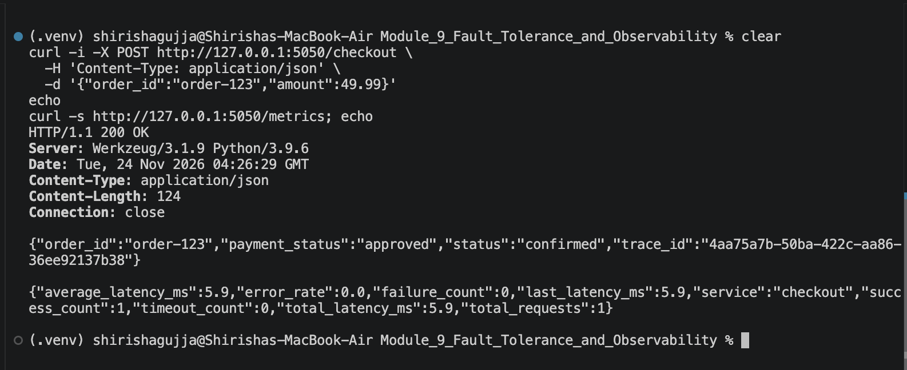
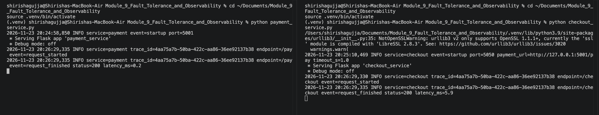
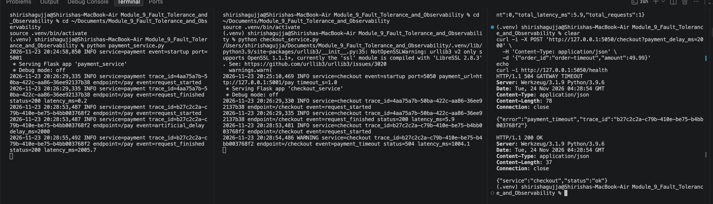

# CMPE 273 – Module 9: Fault Tolerance & Observability

## 1. Overview

This project has two independent Python/Flask services that run as **separate processes** and talk over **HTTP/JSON**:

- **Checkout Service** (`checkout_service.py`, port **5050**) receives `POST /checkout` from a client and calls the Payment Service over HTTP with a **1-second timeout**.
- **Payment Service** (`payment_service.py`, port **5001**) handles `POST /pay` and approves the (fake) payment. For failure testing it can be slowed down on purpose with `?delay_ms=N`.

Both services have basic observability:

- **Request logs** (Python `logging`) with `service`, `trace_id`, `endpoint`, `event`, `status`, `latency_ms`
- **Request latency** measured with `time.monotonic()`
- **In-memory metrics** (`total_requests`, `success_count`, `failure_count`, `error_rate`, `last_latency_ms`, `average_latency_ms`) at `GET /metrics`
- **A shared trace ID**: Checkout generates a UUID per request and sends it to Payment in the `X-Trace-ID` header

When Payment is slow, Checkout returns a clean **504** instead of crashing. The logs, metrics and trace ID show which dependency failed, when it failed, and that the system recovered afterwards.

> **Port note:** The assignment suggests port 5000 for Checkout, but on macOS port 5000 is already used by the AirPlay Receiver (`ControlCenter`). Checkout therefore runs on **5050**. You can change it with `CHECKOUT_PORT=...` (and Payment with `PAYMENT_PORT=...`).

## 2. Architecture Diagram



| Endpoint | Service | Purpose |
|---|---|---|
| `POST /checkout[?payment_delay_ms=N]` | Checkout | Process an order (calls Payment). `payment_delay_ms` is forwarded to Payment for failure testing |
| `POST /pay[?delay_ms=N]` | Payment | Approve payment. `delay_ms` (0–5000) adds an artificial delay |
| `GET /health` | both | Liveness check |
| `GET /metrics` | both | JSON metrics (not Prometheus) |

Failure handling in Checkout:

| Situation | Checkout response |
|---|---|
| Payment answers in under 1 s | `200` `{"status":"confirmed", ...}` |
| Payment takes longer than 1 s (`requests.Timeout`) | `504` `{"error":"payment_timeout"}` |
| Payment unreachable (other `requests.RequestException`) | `503` `{"error":"payment_unavailable"}` |
| Payment returns non-200 | `502` `{"error":"payment_failed"}` |
| Malformed client input | `400` with an error message |

## 3. Install Dependencies

```bash
python3 -m venv .venv
source .venv/bin/activate
python -m pip install -r requirements.txt
```

`requirements.txt` contains only `Flask` and `requests`. Tested with Python 3.9.6, Flask 3.1.3 and requests 2.32.5.

## 4. Running Both Services

Open three terminals (in VS Code: **Terminal → New Terminal**, then click the split icon twice). In each one:

```bash
cd Module_9_Fault_Tolerance_and_Observability
source .venv/bin/activate
```

### Terminal 1 — Payment

```bash
python payment_service.py
```

### Terminal 2 — Checkout

```bash
python checkout_service.py
```

### Terminal 3 — Client commands (curl)

```bash
curl -i http://127.0.0.1:5001/health
curl -i http://127.0.0.1:5050/health
curl -s http://127.0.0.1:5050/metrics; echo
```

**Screenshot 1: Payment (left) and Checkout (middle) started; both `/health` checks return 200 and metrics start at zero (right).**



```text
HTTP/1.1 200 OK
Content-Type: application/json
Content-Length: 36

{"service":"payment","status":"ok"}

HTTP/1.1 200 OK
Content-Type: application/json
Content-Length: 37

{"service":"checkout","status":"ok"}

{"average_latency_ms":0.0,"error_rate":0.0,"failure_count":0,"last_latency_ms":0.0,"service":"checkout","success_count":0,"timeout_count":0,"total_latency_ms":0.0,"total_requests":0}
```

> All evidence in sections 4–10 comes from **one continuous run** on 2026-11-23, shown in screenshots 1–6. The services were not restarted and the metrics were never reset. Text blocks are transcribed from those screenshots.

## 5. Successful Request Evidence

```bash
curl -i -X POST http://127.0.0.1:5050/checkout \
  -H 'Content-Type: application/json' \
  -d '{"order_id":"order-123","amount":49.99}'
echo
curl -s http://127.0.0.1:5050/metrics; echo
```

**Screenshot 2a: client side of a successful request (200 OK, trace ID returned, `success_count` = 1).**



```text
HTTP/1.1 200 OK
Server: Werkzeug/3.1.9 Python/3.9.6
Date: Tue, 24 Nov 2026 04:26:29 GMT
Content-Type: application/json
Content-Length: 124
Connection: close

{"order_id":"order-123","payment_status":"approved","status":"confirmed","trace_id":"4aa75a7b-50ba-422c-aa86-36ee92137b38"}

{"average_latency_ms":5.9,"error_rate":0.0,"failure_count":0,"last_latency_ms":5.9,"service":"checkout","success_count":1,"timeout_count":0,"total_latency_ms":5.9,"total_requests":1}
```

**Screenshot 2b: the same trace ID in Payment's log (left) and Checkout's log (right).**



Checkout log (Terminal 2):

```text
2026-11-23 20:26:29,330 INFO service=checkout trace_id=4aa75a7b-50ba-422c-aa86-36ee92137b38 endpoint=/checkout event=request_started
2026-11-23 20:26:29,335 INFO service=checkout trace_id=4aa75a7b-50ba-422c-aa86-36ee92137b38 endpoint=/checkout event=request_finished status=200 latency_ms=5.9
```

Payment log (Terminal 1), with the **same trace ID**:

```text
2026-11-23 20:26:29,335 INFO service=payment trace_id=4aa75a7b-50ba-422c-aa86-36ee92137b38 endpoint=/pay event=request_started
2026-11-23 20:26:29,335 INFO service=payment trace_id=4aa75a7b-50ba-422c-aa86-36ee92137b38 endpoint=/pay event=request_finished status=200 latency_ms=0.2
```

What this shows: `success_count` went from 0 to 1, `failure_count` stayed 0, and the latency was low (**5.9 ms** end-to-end in Checkout, 0.2 ms inside Payment).

## 6. Timeout Failure Evidence

Payment is told to sleep **2000 ms**, but Checkout only waits **1000 ms**:

```bash
curl -i -X POST 'http://127.0.0.1:5050/checkout?payment_delay_ms=2000' \
  -H 'Content-Type: application/json' \
  -d '{"order_id":"order-timeout","amount":49.99}'
echo
curl -i http://127.0.0.1:5050/health
```

**Screenshot 3: the timeout traced across both services. Payment (left) sleeps 2000 ms and finishes later with 200. Checkout (middle) gives up after about 1000 ms and logs `payment_timeout status=504`. The client (right) receives a 504, and `/health` still returns 200. All of this shares trace ID `b27c2c2a-c79b-410e-be75-b4bb003768f2`.**



Response:

```text
HTTP/1.1 504 GATEWAY TIMEOUT
Server: Werkzeug/3.1.9 Python/3.9.6
Date: Tue, 24 Nov 2026 04:28:54 GMT
Content-Type: application/json
Content-Length: 78
Connection: close

{"error":"payment_timeout","trace_id":"b27c2c2a-c79b-410e-be75-b4bb003768f2"}
```

Checkout log: the timeout is detected after about 1 second and logged at WARNING level:

```text
2026-11-23 20:28:53,481 INFO service=checkout trace_id=b27c2c2a-c79b-410e-be75-b4bb003768f2 endpoint=/checkout event=request_started
2026-11-23 20:28:54,486 WARNING service=checkout trace_id=b27c2c2a-c79b-410e-be75-b4bb003768f2 endpoint=/checkout event=payment_timeout status=504 latency_ms=1004.1
```

Payment log for the same trace ID:

```text
2026-11-23 20:28:53,487 INFO service=payment trace_id=b27c2c2a-c79b-410e-be75-b4bb003768f2 endpoint=/pay event=request_started
2026-11-23 20:28:53,487 INFO service=payment trace_id=b27c2c2a-c79b-410e-be75-b4bb003768f2 endpoint=/pay event=artificial_delay delay_ms=2000
2026-11-23 20:28:55,492 INFO service=payment trace_id=b27c2c2a-c79b-410e-be75-b4bb003768f2 endpoint=/pay event=request_finished status=200 latency_ms=2005.7
```

**The timeout does not cancel Payment's work.** Checkout gave up at `20:28:54,486`, but Payment kept sleeping and finished its own request at `20:28:55,492` (2005.7 ms) with status 200. Nobody was waiting for that response anymore. The timeout only stops Checkout from waiting.

## 7. Checkout Still Running Evidence

`/health`, run immediately after the 504 (right side of Screenshot 3):

```text
HTTP/1.1 200 OK
Server: Werkzeug/3.1.9 Python/3.9.6
Date: Tue, 24 Nov 2026 04:28:54 GMT
Content-Type: application/json
Content-Length: 37
Connection: close

{"service":"checkout","status":"ok"}
```

Checkout caught `requests.Timeout`, returned a JSON error instead of a traceback, and kept serving requests.

## 8. Metrics Evidence

| Moment | total | success | failure | error_rate | last_latency_ms | average_latency_ms |
|---|---|---|---|---|---|---|
| Baseline (Screenshot 1) | 0 | 0 | 0 | 0.0 | 0.0 | 0.0 |
| After 1 success (Screenshot 2a) | 1 | 1 | 0 | 0.0 | 5.9 | 5.9 |
| **After timeout** (Screenshot 4) | 2 | 1 | 1 | **0.5** | **1004.1** | 505.0 |
| After 5 recovered requests (Screenshot 6) | 7 | 6 | 1 | **0.143** | **4.3** | 145.9 |

```bash
curl -s http://127.0.0.1:5050/metrics; echo
curl -s http://127.0.0.1:5001/metrics; echo
```

**Screenshot 4: metrics after the failure. Checkout shows `failure_count` 1, `timeout_count` 1, `error_rate` 0.5 and `last_latency_ms` 1004.1. Payment shows the slow request as a success with `last_latency_ms` 2005.7.**


```text
{"average_latency_ms":505.0,"error_rate":0.5,"failure_count":1,"last_latency_ms":1004.1,"service":"checkout","success_count":1,"timeout_count":1,"total_latency_ms":1010.0,"total_requests":2}

{"average_latency_ms":1003.0,"error_rate":0.0,"failure_count":0,"last_latency_ms":2005.7,"service":"payment","success_count":2,"total_latency_ms":2005.9,"total_requests":2}
```

- `failure_count` went from 0 to 1 and `timeout_count` from 0 to 1
- `error_rate` went from 0.0 to **0.5**
- `last_latency_ms` = **1004.1 ms**, compared with 5.9 ms for the normal request

Payment counts the slow request as a **success** (it did return 200, after 2005.7 ms). Only Checkout counts it as a failure, because Checkout stopped waiting. You need both services' metrics to see the full picture: Payment was **slow**, not broken.

## 9. Trace-ID Evidence

Failed request, trace ID **`b27c2c2a-c79b-410e-be75-b4bb003768f2`** (Screenshot 3):

```text
Checkout:
20:28:53,481 service=checkout trace_id=b27c2c2a-c79b-410e-be75-b4bb003768f2 endpoint=/checkout event=request_started
20:28:54,486 service=checkout trace_id=b27c2c2a-c79b-410e-be75-b4bb003768f2 endpoint=/checkout event=payment_timeout status=504 latency_ms=1004.1

Payment:
20:28:53,487 service=payment  trace_id=b27c2c2a-c79b-410e-be75-b4bb003768f2 endpoint=/pay event=request_started
20:28:53,487 service=payment  trace_id=b27c2c2a-c79b-410e-be75-b4bb003768f2 endpoint=/pay event=artificial_delay delay_ms=2000
20:28:55,492 service=payment  trace_id=b27c2c2a-c79b-410e-be75-b4bb003768f2 endpoint=/pay event=request_finished status=200 latency_ms=2005.7
```

The client got this same ID back in the 504 body. With it you can search both terminals and rebuild the whole story of one request: Checkout started, Payment received the request 6 ms later, Payment was artificially slow, Checkout gave up after about 1 s, and Payment finished on its own about 1 s after that. Without the shared ID, you could not reliably tell which Payment log line belongs to which Checkout request.

## 10. Recovery Evidence

To remove the delay, just send normal requests without `payment_delay_ms`. Nothing was restarted:

```bash
for n in 1 2 3 4 5; do
  curl -s -X POST http://127.0.0.1:5050/checkout \
    -H 'Content-Type: application/json' \
    -d "{\"order_id\":\"order-r$n\",\"amount\":49.99}"
  echo
done
```

**Screenshot 5: five normal requests after the delay was removed. Every one is `confirmed`. Payment (left) logs `status=200` in 0.1–0.2 ms, and Checkout (middle) logs `status=200` in 1.2–4.3 ms, back to normal after the 1004.1 ms timeout.**


Responses:

```text
{"order_id":"order-r1","payment_status":"approved","status":"confirmed","trace_id":"34929f23-f3d1-4d54-a0a7-95ff36a6dcb8"}
{"order_id":"order-r2","payment_status":"approved","status":"confirmed","trace_id":"a8a9fd69-9b91-492b-a557-9d59b4e418cc"}
{"order_id":"order-r3","payment_status":"approved","status":"confirmed","trace_id":"5da8d449-4f14-4145-8eec-f015b0ea903f"}
{"order_id":"order-r4","payment_status":"approved","status":"confirmed","trace_id":"dfe2f28a-4c08-49a7-85a3-3d00b85ab869"}
{"order_id":"order-r5","payment_status":"approved","status":"confirmed","trace_id":"d30b6c99-4f54-45f9-bc23-c357e60bd829"}
```

Checkout log:

```text
2026-11-23 20:36:00,834 INFO service=checkout trace_id=34929f23-f3d1-4d54-a0a7-95ff36a6dcb8 endpoint=/checkout event=request_started
2026-11-23 20:36:00,838 INFO service=checkout trace_id=34929f23-f3d1-4d54-a0a7-95ff36a6dcb8 endpoint=/checkout event=request_finished status=200 latency_ms=3.3
2026-11-23 20:36:00,844 INFO service=checkout trace_id=a8a9fd69-9b91-492b-a557-9d59b4e418cc endpoint=/checkout event=request_started
2026-11-23 20:36:00,845 INFO service=checkout trace_id=a8a9fd69-9b91-492b-a557-9d59b4e418cc endpoint=/checkout event=request_finished status=200 latency_ms=1.3
2026-11-23 20:36:00,851 INFO service=checkout trace_id=5da8d449-4f14-4145-8eec-f015b0ea903f endpoint=/checkout event=request_started
2026-11-23 20:36:00,852 INFO service=checkout trace_id=5da8d449-4f14-4145-8eec-f015b0ea903f endpoint=/checkout event=request_finished status=200 latency_ms=1.3
2026-11-23 20:36:00,858 INFO service=checkout trace_id=dfe2f28a-4c08-49a7-85a3-3d00b85ab869 endpoint=/checkout event=request_started
2026-11-23 20:36:00,860 INFO service=checkout trace_id=dfe2f28a-4c08-49a7-85a3-3d00b85ab869 endpoint=/checkout event=request_finished status=200 latency_ms=1.2
2026-11-23 20:36:00,872 INFO service=checkout trace_id=d30b6c99-4f54-45f9-bc23-c357e60bd829 endpoint=/checkout event=request_started
2026-11-23 20:36:00,876 INFO service=checkout trace_id=d30b6c99-4f54-45f9-bc23-c357e60bd829 endpoint=/checkout event=request_finished status=200 latency_ms=4.3
```

Payment log:

```text
2026-11-23 20:36:00,837 INFO service=payment trace_id=34929f23-f3d1-4d54-a0a7-95ff36a6dcb8 endpoint=/pay event=request_started
2026-11-23 20:36:00,837 INFO service=payment trace_id=34929f23-f3d1-4d54-a0a7-95ff36a6dcb8 endpoint=/pay event=request_finished status=200 latency_ms=0.2
2026-11-23 20:36:00,845 INFO service=payment trace_id=a8a9fd69-9b91-492b-a557-9d59b4e418cc endpoint=/pay event=request_started
2026-11-23 20:36:00,845 INFO service=payment trace_id=a8a9fd69-9b91-492b-a557-9d59b4e418cc endpoint=/pay event=request_finished status=200 latency_ms=0.1
2026-11-23 20:36:00,851 INFO service=payment trace_id=5da8d449-4f14-4145-8eec-f015b0ea903f endpoint=/pay event=request_started
2026-11-23 20:36:00,851 INFO service=payment trace_id=5da8d449-4f14-4145-8eec-f015b0ea903f endpoint=/pay event=request_finished status=200 latency_ms=0.1
2026-11-23 20:36:00,859 INFO service=payment trace_id=dfe2f28a-4c08-49a7-85a3-3d00b85ab869 endpoint=/pay event=request_started
2026-11-23 20:36:00,859 INFO service=payment trace_id=dfe2f28a-4c08-49a7-85a3-3d00b85ab869 endpoint=/pay event=request_finished status=200 latency_ms=0.1
2026-11-23 20:36:00,875 INFO service=payment trace_id=d30b6c99-4f54-45f9-bc23-c357e60bd829 endpoint=/pay event=request_started
2026-11-23 20:36:00,875 INFO service=payment trace_id=d30b6c99-4f54-45f9-bc23-c357e60bd829 endpoint=/pay event=request_finished status=200 latency_ms=0.2
```

Metrics after recovery:

```bash
curl -s http://127.0.0.1:5050/metrics; echo
curl -s http://127.0.0.1:5001/metrics; echo
```

**Screenshot 6: metrics after recovery. Checkout `error_rate` dropped from 0.5 to 0.143, `failure_count` stayed at 1, `success_count` rose to 6, and `last_latency_ms` is back to 4.3.**


```text
{"average_latency_ms":145.9,"error_rate":0.143,"failure_count":1,"last_latency_ms":4.3,"service":"checkout","success_count":6,"timeout_count":1,"total_latency_ms":1021.4,"total_requests":7}

{"average_latency_ms":286.7,"error_rate":0.0,"failure_count":0,"last_latency_ms":0.2,"service":"payment","success_count":7,"total_latency_ms":2006.6,"total_requests":7}
```

- **Error rate decreased:** 0.5 (1 of 2) → **0.143** (1 of 7). The metrics were never reset; the new successes lowered the cumulative rate on their own.
- **Failure count stopped increasing:** it stayed at 1, while `success_count` went from 1 to 6.
- **Latency returned to normal:** recovered Checkout requests took 3.3, 1.3, 1.3, 1.2 and 4.3 ms. That is in line with the 5.9 ms baseline, compared with 1004.1 ms for the timed-out request. `average_latency_ms` (145.9) is still pulled up by the single slow request, because it is a cumulative average.

### Extra: other failure paths (verified in an earlier test run)

These were checked in a separate, earlier run (not shown in the screenshots). The output is real.

Malformed input returns 400:

```text
$ curl -s -X POST http://127.0.0.1:5050/checkout -H 'Content-Type: application/json' -d '{"order_id":"","amount":-1}'
{"error":"order_id must be a non-empty string","trace_id":"d535382c-bf0b-4195-93b4-1979864c463d"}
```

With Payment stopped (Ctrl+C in Terminal 1), Checkout returns 503 and stays healthy:

```text
{"error":"payment_unavailable","trace_id":"28bc05f6-5822-4f1c-93f5-8c57fb1dee5c"}
HTTP 503
{"service":"checkout","status":"ok"}
HTTP 200
```

```text
2026-11-23 20:02:10,931 WARNING service=checkout trace_id=28bc05f6-5822-4f1c-93f5-8c57fb1dee5c event=payment_unreachable error=ConnectionError
2026-11-23 20:02:10,931 WARNING service=checkout trace_id=28bc05f6-5822-4f1c-93f5-8c57fb1dee5c endpoint=/checkout event=payment_unavailable status=503 latency_ms=1.7
```

## 11. Screenshots / Logs / Terminal Output

| # | File | Shows |
|---|---|---|
| 1 | [`screenshots/01-startup.png`](screenshots/01-startup.png) | Both services started, `/health` 200, metrics at zero |
| 2a | [`screenshots/02a-success-client.png`](screenshots/02a-success-client.png) | Successful checkout response and metrics |
| 2b | [`screenshots/02b-success-logs.png`](screenshots/02b-success-logs.png) | Same trace ID in Payment and Checkout logs |
| 3 | [`screenshots/03-timeout.png`](screenshots/03-timeout.png) | 504 timeout, matching trace ID in both logs, `/health` still 200 |
| 4 | [`screenshots/04-metrics-after-failure.png`](screenshots/04-metrics-after-failure.png) | Failure count, error rate and latency after the timeout |
| 5 | [`screenshots/05-recovery-requests.png`](screenshots/05-recovery-requests.png) | Five successful requests after the delay was removed |
| 6 | [`screenshots/06-metrics-after-recovery.png`](screenshots/06-metrics-after-recovery.png) | Error rate down to 0.143, latency back to normal |

All screenshots and log excerpts come from real runs. None of the trace IDs, logs, metrics or latency values were made up.

You may also see a `NotOpenSSLWarning` from urllib3 when Checkout starts (visible in Screenshot 1). It appears because macOS's system Python is built with LibreSSL, and it does not affect plain-HTTP calls to localhost.

## Reflection

**How do logs, traces, and metrics help diagnose failures in a distributed system?**

Logs tell us what happened inside each service. In this lab, Checkout logged a `payment_timeout` with status 504 after about 1000 ms, and Payment logged that it was artificially delayed. The shared trace ID connects those separate log lines, so I could follow one exact request from Checkout into Payment and see that Payment was slow rather than crashed. Metrics show the bigger pattern that a single log line can't, like the error rate jumping to 0.5 and latency spiking to over a second, which tells us that something is wrong and when it started. Together they point to which dependency failed. They also let us confirm recovery: after the delay was removed, the error rate dropped to 0.143 and latency went back to a few milliseconds.
